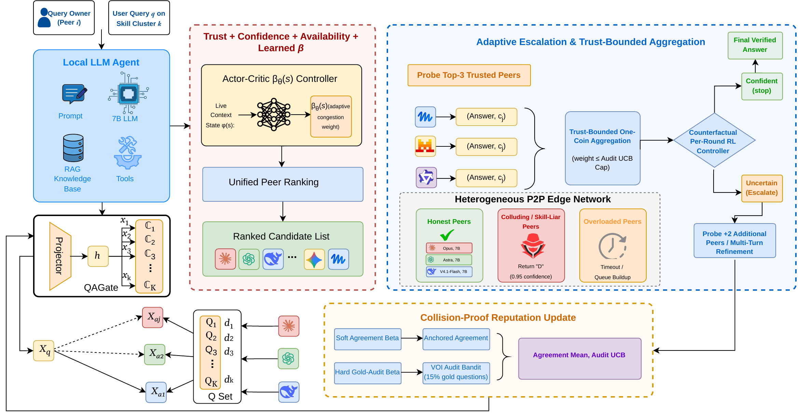
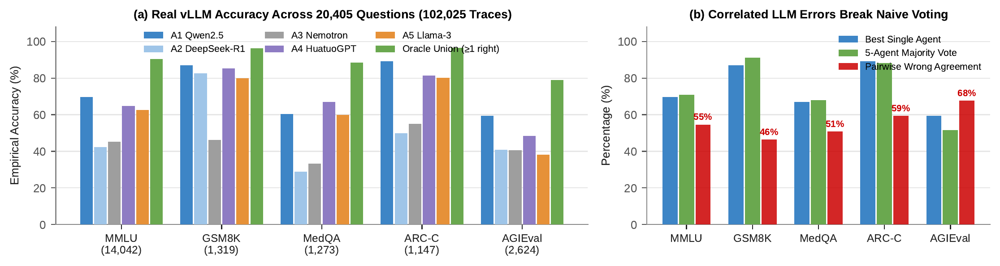
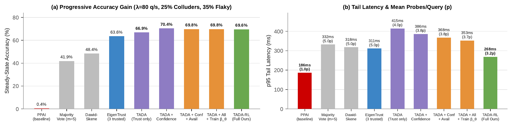
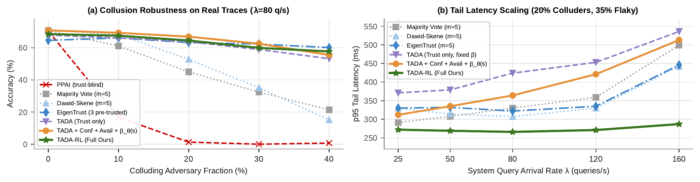
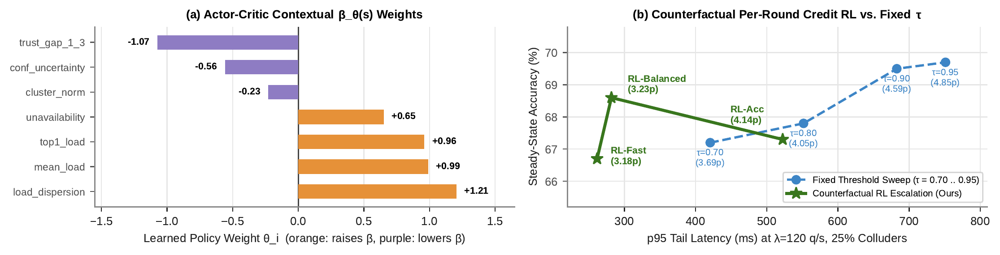
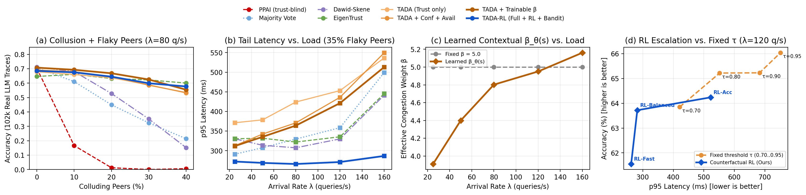

# TADA-RL: Trust-, Confidence-, and Availability-Aware Delegation for Decentralized LLM-Agent Networks

**Group 21 · CSC 8220 (Advanced Computer Networks, Fall 2026) · Adele Chinda, Trilok Padhi**  
Follow-up to *PPAI: Enabling Personalized LLM Agent Interoperability for Collaborative Edge Intelligence* (IEEE INFOCOM 2026).

> **Zero pre-trusted peers · 102,025 real 7–8B vLLM traces · 69.6% steady-state accuracy under 25% colluders & 35% flaky links (vs. 0.4% PPAI) · 268.4 ms p95 tail latency**

---

## 1. Overview & System Architecture

Decentralized edge-intelligence overlays such as **PPAI** route each query to the peer whose agent *self-reports* the highest capability score and lowest queue load. In an open peer-to-peer (P2P) edge network with no trusted third party, four failure modes break PPAI and classical ensembles:

- **Skill Liars & Coordinated Colluders:** Malicious peers advertise `0.95` capability everywhere, coordinate on identical wrong distractors, and fabricate `confidence = 0.95`, collapsing PPAI from `70.4%` to `0.0%–0.4%` and breaking majority voting and unsupervised Dawid–Skene EM.
- **Whitewashers & Camouflage Adversaries:** Colluders reset identities once flagged or behave honestly `30%` of the time to evade naive anomaly detectors.
- **Correlated LLM Errors & CoT Truncation:** Real 7–8B reasoning models (`DeepSeek-R1-Distill`, `Nemotron`) share `46%–68%` pairwise wrong-answer agreement and suffer a `~2x` accuracy drop when chains of thought truncate before reaching an explicit answer marker.
- **Flaky Edge Availability & Dynamic Congestion:** Edge nodes experience transient dropouts (`35%` flaky peers with availability between `0.45` and `0.85`), while a static congestion weight `β` and fixed stopping threshold `τ` cannot adapt across light vs. saturated arrival rates `λ`.

<p align="center">
  
</p>

*(Vector PDF: [`results/figures/tada_rl_architecture.pdf`](results/figures/tada_rl_architecture.pdf))*

### Core Contributions in TADA-RL

1. **Audit-Capped Beta Reputation & LCB-Anchored Agreement (`tad/trust.py`)**  
   Maintains two independent Beta estimates per peer and skill cluster: a soft *agreement* Beta (updated from peer consensus) and a hard *gold-audit* Beta (updated from spot checks). Effective trust is capped by the peer's per-cluster and pooled audit upper confidence bounds (UCBs), and soft agreement only updates when the winning answer also holds under pessimistic audit-only lower confidence bound (LCB) voting—blocking unaudited coalitions and whitewashers from boosting each other.
2. **Value-of-Information (VOI) Spot-Audit Bandit & Bootstrap Audits (`tad/trust.py`, `tad/routing.py`)**  
   Dynamically scales the spot-audit rate between `4%` and `40%` based on committee uncertainty and targets gold canary questions toward shortlisted peers with the highest uncertainty and disagreement against anchored consensus, while supporting optional join-time bootstrap audits for new peers.
3. **Trust-Bounded Agent Confidence & Observed Availability (`tad/trust.py`, `tad/routing.py`)**  
   Extracts per-response self-confidence from chain-of-thought completions (`0.15`–`0.96`) and tracks each peer's observed link availability via an online Beta estimator. Peer ranking combines availability, audited trust, historical confidence, and congestion-adjusted queue load. During one-coin Bayesian voting, confidence boosts are strictly capped by each peer's audit UCB so overconfident adversaries cannot inflate their vote weight.
4. **GPU-Trained Contextual `β(s)` Controller (`tad/trainable_beta.py`)**  
   Replaces PPAI's static congestion weight `β` with a learned contextual policy conditioned on an 8-D live shortlist state (`mean_load`, `load_dispersion`, `top1_load`, `trust_gap_top1_top3`, `unavailability`, `confidence_uncertainty`, and `cluster_norm`). Trained via a PyTorch Actor-Critic network on CUDA and refined with Cross-Entropy Method (CEM) optimization in the discrete-event simulator.
5. **Counterfactual Per-Round Credit RL Escalation & Self-Supervision (`tad/routing.py`)**  
   Probes the top-3 trusted peers in parallel in round 1 and uses a learned Q-policy to decide whether to stop or escalate (`+2` peers). Training uses decoupled counterfactual per-round rewards—comparing the exact accuracy of stopping at round `r` against the marginal accuracy, probe cost, and latency cost of escalating—with optional label-free online adaptation (`online_self_supervised=True`).

---

## 2. Complete 5-Agent Real LLM Trace Bank (`102,025` Traces)

All `20,405` benchmark items across five standard suites have been evaluated across all five PPAI 7–8B checkpoints (`102,025` total traces) using `collect/collect_answers.py`. A compressed `275 KB` snapshot (`data/traces_compact.npz`) preserving rotated multiple-choice error correlations and extracted confidences is included so `use_traces=True` runs immediately after `git clone`.

| Agent | Hugging Face Checkpoint | MMLU (14,042) | GSM8K (1,319) | MedQA (1,273) | ARC-C (1,147) | AGIEval (2,624) |
|---|---|---:|---:|---:|---:|---:|
| **A1_qwen** | `Qwen/Qwen2.5-7B-Instruct` | **69.7%** | **87.0%** | 60.3% | **89.3%** | **59.4%** |
| **A2_deepseek** | `deepseek-ai/DeepSeek-R1-Distill-Qwen-7B` | 42.2% | 82.7% | 28.8% | 49.8% | 40.8% |
| **A3_nemotron** | `nvidia/OpenCodeReasoning-Nemotron-7B` | 45.2% | 46.3% | 33.2% | 54.9% | 40.6% |
| **A4_huatuo** | `FreedomIntelligence/HuatuoGPT-o1-7B` | 64.8% | 85.4% | **67.1%** | 81.4% | 48.3% |
| **A5_llama** | `NousResearch/Meta-Llama-3-8B-Instruct` | 62.7% | 80.0% | 59.9% | 80.2% | 38.2% |
| **5-Agent Majority Vote** | Unweighted plurality | **70.9%** | **91.3%** | **67.9%** | 88.2% | 51.5% |
| **Oracle Union** | At least 1 of 5 correct | 90.5% | 96.3% | 88.5% | 96.6% | 78.9% |
| **Pairwise Wrong Agreement** | Conditional wrong-option collision | 54.6% | 46.4% | 50.8% | 59.4% | 67.7% |

<p align="center">
  
</p>

---

## 3. Experimental Results

All main real-trace experiments simulate `50` peers (`35%` flaky edge nodes with availability in `[0.45, 0.85]` and `80 ms` retry penalty) in a discrete-event FIFO M/M/1 network (`tad/simulator.py`), averaged across `8` random seeds (`1,200` queries/run). Note that EigenTrust is granted `3` globally pre-trusted honest peers, whereas TADA-RL uses **zero pre-trusted peers**.

### 3.1 Progressive Ablation (`λ = 80 q/s`, `25%` Colluders, `35%` Flaky Peers)

<p align="center">
  
</p>

| Method | Accuracy | Steady-State Acc | p95 Latency | Probes / Query | Mean β |
|---|---:|---:|---:|---:|---:|
| **PPAI (trust-blind)** | 0.4% ± 0.4% | 0.4% | 186.3 ms | 1.00 | 5.00 |
| **Majority Vote (m=5)** | 41.7% ± 3.3% | 41.9% | 332.2 ms | 5.00 | 5.00 |
| **Dawid–Skene (m=5)** | 47.9% ± 5.9% | 48.4% | 318.0 ms | 5.00 | 5.00 |
| **EigenTrust (m=5, 3 pre-trusted)** | 63.0% ± 2.4% | 63.6% | 311.3 ms | 5.00 | 5.00 |
| **TADA (Trust only, fixed β=5)** | 62.5% ± 1.7% | 66.9% | 414.8 ms | 3.99 | 5.00 |
| **TADA + Agent Confidence** | 65.0% ± 2.2% | **70.4%** | 385.7 ms | 3.79 | 5.00 |
| **TADA + Confidence + Availability** | 64.9% ± 3.5% | 69.8% | 367.7 ms | 3.80 | 5.00 |
| **TADA + Conf + Avail + Trainable β(s)** | **65.9% ± 2.0%** | 69.8% | 352.6 ms | 3.68 | 4.87 |
| **TADA-RL (Full + Counterfactual RL + VOI Bandit)** | **65.3% ± 2.7%** | **69.6%** | **268.4 ms** | **3.20** | 4.72 |

### 3.2 Collusion Robustness & Arrival-Rate Scaling

<p align="center">
  
</p>

- **Collusion Resilience (`0% → 40%` Colluders, `λ = 80 q/s`):** PPAI drops to `16.7%` at `10%` adversaries and `0.0%` at `30%`, while Majority Vote (`21.4%`) and Dawid–Skene (`15.2%`) collapse by `40%` collusion. Full **TADA-RL** sustains `68.5% → 57.7%` accuracy without any pre-trusted peers (and `TADA + Conf + Avail + β(s)` reaches `70.8% → 55.5%`).
- **Flat Tail Latency Under Load (`λ = 25 → 160 q/s`, `20%` Colluders):** At `160 q/s`, `m=5` baselines spike to `442–499 ms` p95 and fixed-`β` TADA hits `536 ms`. **TADA-RL** stays nearly flat between **`266 ms` and `287 ms` p95** across the entire load range.

### 3.3 Learned Contextual `β(s)` Weights & Counterfactual RL Pareto Frontier

<p align="center">
  
</p>

| Escalation Policy (`λ = 120 q/s`, `25%` Colluders) | Accuracy | Steady-State Acc | p95 Latency | Probes / Query |
|---|---:|---:|---:|---:|
| Fixed Threshold `τ = 0.70` | 63.8% | 67.2% | 420.6 ms | 3.69 |
| Fixed Threshold `τ = 0.80` | 65.2% | 67.8% | 551.7 ms | 4.05 |
| Fixed Threshold `τ = 0.90` | 65.2% | 69.5% | 682.7 ms | 4.59 |
| Fixed Threshold `τ = 0.95` | **66.0%** | **69.7%** | 751.1 ms | 4.85 |
| **RL Escalation (Accuracy-Focused)** | 64.2% | 67.3% | 522.4 ms | 4.14 |
| **RL Escalation (Balanced)** | 63.7% | **68.6%** | **281.8 ms** | **3.23** |
| **RL Escalation (Low-Latency)** | 61.6% | 66.7% | **261.7 ms** | **3.18** |

<details>
<summary><b>4-Panel End-to-End Summary & Attack-Persona Component Ablations</b></summary>

<p align="center">
  
</p>

#### Component Ablation Across Attack Personas (`30%` Adversaries)

| Method | No Attack | 30% Liars | 30% Colluders | + Whitewash | + Camouflage | Probes | p95 (ms) |
|---|---:|---:|---:|---:|---:|---:|---:|
| **TADA (full)** | 0.80 | **0.77** | **0.76** | **0.74** | **0.76** | 4.2 | 388 |
| &nbsp;&nbsp;− anchoring | 0.81 | 0.79 | 0.62 | 0.51 | 0.66 | 4.2 | 357 |
| &nbsp;&nbsp;− audits | 0.75 | 0.57 | 0.41 | 0.41 | 0.60 | 4.8 | 425 |
| &nbsp;&nbsp;− pooled audit cap | 0.81 | 0.77 | 0.76 | 0.74 | 0.76 | 4.2 | 376 |
| &nbsp;&nbsp;− sequential (ask 5 at once) | 0.82 | 0.79 | 0.78 | 0.73 | 0.78 | 5.1 | 280 |
| **EigenTrust (m=5)** | 0.67 | 0.67 | 0.65 | 0.66 | 0.67 | 5.0 | 317 |
| **Dawid–Skene (m=5)** | 0.87 | 0.77 | 0.01 | 0.01 | 0.35 | 5.0 | 330 |
| **Majority Vote (m=5)** | 0.88 | 0.27 | 0.12 | 0.12 | 0.31 | 5.0 | 268 |

Full tables and raw JSON outputs are stored in [`results/trust_conf_avail_beta.md`](results/trust_conf_avail_beta.md), [`results/real_traces_results.md`](results/real_traces_results.md), and [`results/ablation_table.md`](results/ablation_table.md).

</details>

---

## 4. Repository Structure

```text
.
├── tad/                        # Core TADA-RL simulator, trust, routing, and controllers
│   ├── simulator.py            # Discrete-event FIFO M/M/1 network simulator & Config
│   ├── routing.py              # PPAI, Majority, Dawid-Skene, EigenTrust, and TADA-RL policies
│   ├── trust.py                # AuditedBeta, LCB anchoring, VOI bandit, one-coin aggregation
│   ├── trainable_beta.py       # 8-D context features phi(s) & contextual beta_theta(s) policy
│   ├── traces.py               # TraceBank loader (reads data/traces_compact.npz out of the box)
│   ├── peers.py                # Honest, skill-liar, colluder, whitewasher, flaky peer fleet
│   ├── policies.py             # Escalation policies & helper utilities
│   ├── profiles.py             # Benchmark clusters & empirical PPAI profiles
│   └── metrics.py              # Accuracy, steady-state, p95 latency, probe & exposure metrics
├── experiments/                # Training & evaluation scripts
│   ├── train_beta_confidence.py# GPU Actor-Critic + CEM + Counterfactual RL benchmark suite
│   ├── run_all.py              # Robustness, cost, load, RL, and attack-persona ablation sweeps
│   └── make_architecture_figure.py
├── collect/                    # vLLM / HuggingFace real-answer trace collection pipeline
│   ├── collect_answers.py
│   ├── benchmarks.py
│   ├── models.py
│   ├── generate.py
│   ├── prompts.py
│   └── status.py
├── scripts/
│   ├── run_gpu_sequence.sh     # End-to-end GPU pipeline runner
│   └── run_collect.sh          # Real LLM trace collection helper
├── data/
│   └── traces_compact.npz      # Compressed 102,025-trace snapshot (275 KB)
├── results/                    # Saved tables, JSON outputs, learned weights, and figures/
├── tests/
│   └── test_tad.py             # Unit & integration tests (pytest)
├── requirements.txt
└── README.md
```

---

## 5. Quick Start & Reproducibility

### Installation & Tests

```bash
pip install -r requirements.txt
python -m pytest -q
```

### Reproduce Training & Benchmarks

```bash
# 1. Train contextual beta_theta(s) (PyTorch Actor-Critic + CEM) & counterfactual RL escalation
python -m experiments.train_beta_confidence

# 2. Run robustness, cost, load, RL, and attack-persona ablation sweeps
python -m experiments.run_all
```

### Python API (Works Immediately with `data/traces_compact.npz`)

```python
from tad.simulator import Config, run

res = run(Config(
    policy="tada",
    use_traces=True,
    use_confidence=True,
    use_availability=True,
    beta_trainable=True,
    audit_bandit=True,
    adaptive_audit=True,
    escalation="rl",
))
print(f"Steady Acc: {res['accuracy_steady']:.1%}, p95: {res['latency_p95_ms']:.1f} ms, Probes: {res['probes_per_query']:.2f}")
```

### Optional: Re-collect Raw LLM Traces from Hugging Face / vLLM

Raw `.jsonl` traces are omitted from git for size; to regenerate them on GPU:

```bash
./scripts/run_collect.sh all all
python -m collect.status
```
