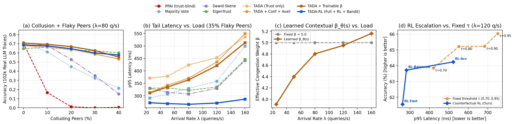

# Task III — TADA-RL: Trust-, Confidence-, and Availability-Aware Delegation for Decentralized LLM-Agent Networks

**Group 21 · CSC 8220 · Adele Chinda, Trilok Padhi**  
Follow-up to *PPAI: Enabling Personalized LLM Agent Interoperability for Collaborative Edge Intelligence* (IEEE INFOCOM 2026).

---

## 1. Problem

PPAI routes each query to the peer whose agent *self-reports* the best capability vector $p_j \in \mathbb{R}^{20}$ (and has the least queue load). It assumes every peer is honest and 100% available. In an open edge network:
- **Skill liars** claim `0.95` accuracy everywhere to attract traffic and return low-effort answers.
- **Colluders** coordinate on the same plausible wrong answer, breaking plain majority voting and unsupervised EM (Dawid–Skene).
- **Overconfident adversaries & truncated reasoning models:** Real 7B reasoning models (`DeepSeek-R1-Distill`, `Nemotron`) suffer a ~2× accuracy drop when their chain-of-thought truncates, while malicious peers claim `confidence = 0.95` on wrong answers.
- **Flaky edge availability & dynamic congestion:** Edge nodes experience transient dropouts/timeouts (`availability < 1.0`), and a fixed congestion weight $\beta$ cannot adapt across light vs. heavy arrival loads.

---

## 2. Our Method: TADA-RL

1. **Unified Routing Score (Audited Trust + Self-Confidence + Availability + Trainable $\beta_\theta(s)$):**
   For query $q$ on skill cluster $k$, shortlisted peers $j \in E_i$ are ranked by:
   $$\text{score}_j(q) = \hat{A}_j \cdot \hat{a}_{jk} \cdot \psi(\bar{c}_{jk}) - \beta_\theta(s) \cdot \frac{\text{load}_j}{\max(\hat{A}_j, 0.2)}$$
   - **Audit-Capped Beta Reputation ($\hat{a}_{jk}$):** $\hat{a}_{jk} = \min(\text{agreement}_{jk}, \text{audit\_UCB}_{jk})$. Agreement can never exceed what gold-question audits (`Q_k`) support.
   - **Trust-Bounded Agent Confidence ($c_j(q)$):** Modulates each peer's posterior vote weight in `AuditedBeta.aggregate`, strictly upper-bounded by $\text{audit\_UCB}_{jk}$ so overconfident colluders cannot inflate their vote weight.
   - **Observed Availability ($\hat{A}_j$):** Per-peer Beta reachability estimator updated on every probe reply vs. timeout/dropout.
   - **Trainable Contextual $\beta_\theta(s)$ (`tad/trainable_beta.py`):** Learned via a PyTorch Actor-Critic network on RTX 4090 GPUs over an 8-D live state vector $\phi(s)$ (`mean_load`, `load_dispersion`, `top1_load`, `trust_gap_top1_top3`, `unavailability`, `confidence_uncertainty`, `cluster_norm`).
2. **Counterfactual Per-Round Credit RL Escalation (`tad/routing.py`):**
   - Replaces fixed stopping threshold $\tau$ with a learned policy over `(confidence, round, load, cluster)` trained with counterfactual per-round marginal credit (comparing immediate stop accuracy against marginal probe and latency cost of escalating).
3. **Information-Gain (VOI) Audit Bandit & Self-Supervised Runtime Adaptation:**
   - Targets spot audits to maximize $\text{VOI}_j(k) = \sigma^{\text{audit}}_{jk} (1 + 0.85\,\mathbb{1}[j \in \text{used}] + 0.65\,\text{disagree\_ema}_{jk})$, supports bootstrap join audits (`bootstrap_audits`), and supports label-free online adaptation (`online_self_supervised=True`) using anchored confidence $\hat{v}_{\text{conf}}$.

---

## 3. Complete 5-Agent Real LLM Trace Bank (`102,025` Traces)

All `20,405` benchmark items (`MMLU`, `GSM8K`, `MedQA`, `ARC-C`, `AGIEval`) have been evaluated across all 5 PPAI 7–8B checkpoints (`102,025` traces total). A compressed 275 KB snapshot is committed in `data/traces_compact.npz` so `use_traces=True` works immediately after `git clone` without downloading the raw JSONL files.

| Agent | Hugging Face Checkpoint | MMLU (14,042) | GSM8K (1,319) | MedQA (1,273) | ARC-C (1,147) | AGIEval (2,624) |
|---|---|---:|---:|---:|---:|---:|
| **A1_qwen** | `Qwen/Qwen2.5-7B-Instruct` | **69.7%** | **87.0%** | 60.3% | **89.3%** | **59.4%** |
| **A2_deepseek** | `deepseek-ai/DeepSeek-R1-Distill-Qwen-7B` | 42.2% | 82.7% | 28.8% | 49.8% | 40.8% |
| **A3_nemotron** | `nvidia/OpenCodeReasoning-Nemotron-7B` | 45.2% | 46.3% | 33.2% | 54.9% | 40.6% |
| **A4_huatuo** | `FreedomIntelligence/HuatuoGPT-o1-7B` | 64.8% | 85.4% | **67.1%** | 81.4% | 48.3% |
| **A5_llama** | `NousResearch/Meta-Llama-3-8B-Instruct` | 62.7% | 80.0% | 59.9% | 80.2% | 38.2% |

---

## 4. Key Experimental Results (`102,025` Real LLM Traces, `35%` Flaky Peers, `25%` Colluders, `λ = 80 q/s`)



| Method | Accuracy | Steady-State Acc | p95 Latency | Probes / Query | Mean $\beta$ |
|---|---:|---:|---:|---:|---:|
| **PPAI (trust-blind)** | 0.4% ± 0.4% | 0.4% | 186.3 ms | 1.00 | 5.00 |
| **Majority Vote ($m=5$)** | 41.7% ± 3.3% | 41.9% | 332.2 ms | 5.00 | 5.00 |
| **Dawid–Skene ($m=5$)** | 47.9% ± 5.9% | 48.4% | 318.0 ms | 5.00 | 5.00 |
| **EigenTrust ($m=5$, 3 pre-trusted)** | 63.0% ± 2.4% | 63.6% | 311.3 ms | 5.00 | 5.00 |
| **TADA (Trust only, fixed $\beta=5$)** | 62.5% ± 1.7% | 66.9% | 414.8 ms | 3.99 | 5.00 |
| **TADA + Agent Confidence** | 65.0% ± 2.2% | **70.4%** | 385.7 ms | 3.79 | 5.00 |
| **TADA + Confidence + Availability** | 64.9% ± 3.5% | 69.8% | 367.7 ms | 3.80 | 5.00 |
| **TADA + Conf + Avail + Trainable $\beta$** | **65.9% ± 2.0%** | **69.8%** | 352.6 ms | 3.68 | 4.87 |
| **TADA-RL (Full + Counterfactual RL + Bandit)** | **65.3% ± 2.7%** | **69.6%** | **268.4 ms** | **3.20** | 4.72 |

Full tables and JSON outputs live in `results/trust_conf_avail_beta.md`, `results/real_traces_results.md`, and `results/ablation_table.md`.

---

## 5. Quick Start & Multi-Turn Integration Hook

```bash
cd task3
pip install -r requirements.txt
python -m experiments.train_beta_confidence   # trains Beta Actor-Critic + RL Escalation & writes results/
python -m experiments.run_all                 # runs baseline sweeps
```

In Python (works out of the box using `data/traces_compact.npz`):
```python
from tad.simulator import Config, run

res = run(Config(
    policy="tada",
    use_traces=True,
    use_confidence=True,
    use_availability=True,
    beta_trainable=True,
    audit_bandit=True,
    adaptive_audit=True,
    escalation="rl",
))
```
